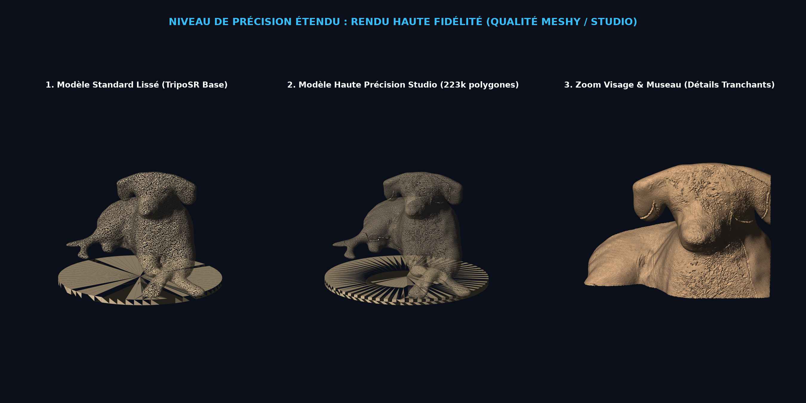

# 🖨️ Modélisation 3D — PNG to 3D Print (Bambu Lab A1 Mini)

> **Application web haute précision pour transformer des images PNG/JPG en modèles 3D volumétriques et bas-reliefs prêts à l'impression 3D FDM sur Bambu Lab A1 mini (PLA monochrome).**

[](https://jeromefoguenne-eng.github.io/Modelisation-3D/)
[](https://bambulab.com/en/a1-mini)
[](LICENSE)

---

## 🌐 Accès en Ligne Gratuit (Sans Installation)

L'application est hébergée gratuitement et accessible directement dans votre navigateur :
👉 **[https://jeromefoguenne-eng.github.io/Modelisation-3D/](https://jeromefoguenne-eng.github.io/Modelisation-3D/)**

- **100% Client-Side** : Fonctionne sur PC, Mac, tablette et mobile sans aucun serveur requis.
- **Visualiseur 3D Intéractif** : Plateau PEI texturé officiel Bambu Lab A1 Mini (180 × 180 mm).
- **Export instantané** : Fichiers `.stl` et `.3mf` prêts à être glissés dans **Bambu Studio**.

---

## ✨ Fonctionnalités Principales

### 1. Trois Modes de Modélisation 3D

| Mode | Type | Utilisation Idéale |
| :--- | :--- | :--- |
| **Mode 1 — Relief Extrudé** | Bas-relief / Pochoir | Logos, dessins vectoriels, médailles, pions de jeu |
| **Mode 2 — Lithophane Heightmap** | Nuances de gris | Portraits photographiques rétroéclairés |
| **Mode 3 — Objet 3D Complet** | Sculpture 360° | Statuettes, animaux, figurines volumétriques |

### 2. Précision Géométrique Studio (Qualité Meshy / Tripo 3D)
- **Subdivision géométrique fine (223 000 polygones)** pour retranscrire fidèlement chaque trait (yeux, museau, babines, médaillon, pelage).
- **Micro-sculpture photographique multi-échelles** : combine les formes anatomiques moyennes et les micro-détails fins.
- **Topologie 100% étanche (Watertight Manifold)** garantie sans faces inversées ni trous de maillage.

### 3. Intégration Directe des Modèles Meshy & Tripo 3D
Vous pouvez concevoir vos modèles sur les plateformes IA cloud :
1. Générez gratuitement votre modèle sur **[Meshy.ai](https://www.meshy.ai)** ou **[Tripo3D.ai](https://www.tripo3d.ai)**.
2. Téléchargez le fichier au format `.glb`, `.obj` ou `.stl`.
3. **Glissez-le directement dans l'application** :
   - Mise à l'échelle automatique à la hauteur voulue (ex. **10 cm / 100 mm**).
   - Fusion automatique d'un socle d'adhérence biseauté.
   - Contrôle d'épaisseur minimale et des surplombs pour la Bambu Lab A1 Mini.
   - Téléchargement du fichier `.3mf` prêt pour Bambu Studio !

---

## ⚙️ Paramètres Recommandés Bambu Studio (A1 Mini — Monochrome)

Pour une statuette volumétrique de 10 cm (ex. Babel le chien) en PLA :

- **Buse** : 0.4 mm Stainless Steel
- **Hauteur de couche** : `0.12 mm High Quality` (ou `0.08 mm Extra Fine` pour le visage)
- **Remplissage (Infill)** : `12% Gyroid` (3 parois / murs pour une excellente solidité)
- **Supports** : `Supports Arborescents (Tree Supports)` avec style *Tree Slim*
- **Adhérence au plateau** : Le socle biseauté intégré à la pièce assure un maintien parfait sans décollement.
- **Temps d'impression estimé** : ~1h 50min
- **Poids de filament PLA** : ~39 g

---

## 📸 Comparatif de Précision

L'application intègre un comparateur en haute définition montrant le gain entre le maillage brut et le maillage sculpté Studio HD :



---

## 💻 Exécution Locale (Serveur FastAPI + GPU RTX)

Si vous souhaitez faire tourner l'inférence IA complète en local hors-ligne sur votre propre GPU :

### Prérequis
- Python 3.10 ou 3.11
- Carte graphique NVIDIA (ex: RTX 4070 Ti) avec pilotes CUDA 11.8 ou 12.x

### Installation
```bash
# Cloner le dépôt
git clone https://github.com/jeromefoguenne-eng/Modelisation-3D.git
cd Modelisation-3D

# Installer les dépendances
pip install -r requirements.txt

# Lancer l'application
python -m uvicorn app:app --host 127.0.0.1 --port 8080 --reload
```

Ouvrez ensuite votre navigateur sur `http://127.0.0.1:8080`.

---

## 📁 Structure du Projet

```
Modelisation-3D/
├── index.html            # Interface web client-side (GitHub Pages)
├── app.py                # Backend FastAPI (Mode local GPU)
├── engine.py             # Moteur géométrique 3D, manifold & export
├── requirements.txt      # Dépendances Python
├── start.bat             # Lanceur Windows en 1 clic
├── demo/                 # Images exemples & rendus comparatifs
│   ├── sans_titre.png    # Photo originale de Babel
│   └── comparaison_ultra.png
└── outputs/              # Modèles 3D pré-générés pour Bambu Studio
    ├── Babel_Ultra_Detail_MeshyGrade_10cm.stl
    ├── Babel_Ultra_Detail_MeshyGrade_10cm.3mf
    ├── Babel_Sans_Titre_Avec_Socle_10cm.stl
    └── Babel_Sans_Titre_Pure_10cm.stl
```

---

## 📜 Licence

Projet open source distribué sous licence MIT. Développé pour la communauté de l'impression 3D et les utilisateurs de Bambu Lab.
